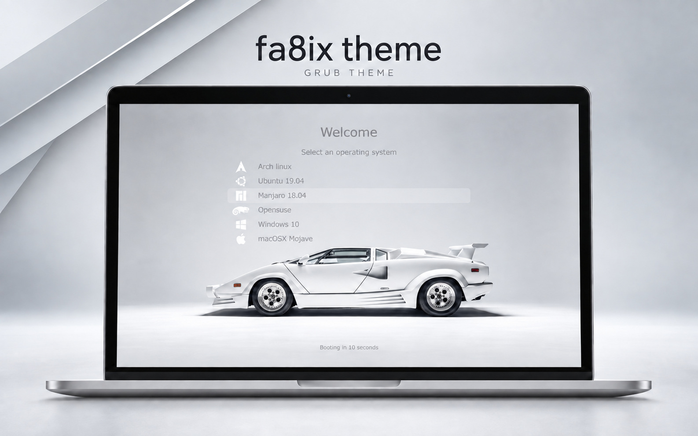

# fa8ix theme

A light GRUB theme with a monochrome sports-car background, based on **Vimix** by [vinceliuice](https://github.com/vinceliuice/grub2-themes).



The cover is a promotional mockup with example operating systems copied from the reference image. Your actual entries come from GRUB and your installed systems; installing this theme does not add the systems shown in the cover.

## Features

- English welcome screen: **Welcome**, **Select an operating system**, and **Booting in … seconds**.
- Proportional wallpaper scaling for **16:9 and 16:10**, anchored at the top and cropped only at the bottom.
- The menu stays above the car. Use the arrow keys to reach additional entries.
- Standard layout for 2560-pixel-wide screens and a compact preset for 1920-pixel-wide screens.
- Recovery and Memtest entries enabled when supplied by the installed system; other operating systems detected through os-prober.
- Configuration backups and a restore command.

## Install on Ubuntu / Debian

Requires a working graphical GRUB installation, Bash, Python 3, `flock`, `grub-mkconfig` and `grub-script-check`. Memtest and os-prober must be installed separately if you want their entries.

```sh
git clone https://github.com/fa8i/fa8ix-theme.git
cd fa8ix-theme
sudo ./install.sh
```

For 1920 × 1080 or 1920 × 1200:

```sh
sudo ./install.sh --compact
```

The installer uses `/boot/grub/themes/fa8ix-theme`, enables the menu and available diagnostic/recovery entries, and validates a candidate GRUB configuration before activation. It preserves the configured graphics resolution, timeout and kernel parameters. If GRUB is configured for a lower resolution or text output, select a supported graphics mode before installing the matching preset.

Backups are stored under `/var/backups/fa8ix-theme/`. The installer prints the exact restore command:

```sh
sudo ./install.sh --restore /var/backups/fa8ix-theme/BACKUP-ID
```

Restore recovers a configuration snapshot. If the installed kernels have changed since that snapshot, run `sudo update-grub` after restoring.

## Customize

Edit `theme/theme.txt` for the standard preset or `theme/theme-1920.txt` for the compact preset, then rerun the installer. Title, instruction and menu begin at 11%, 19% and 26% of screen height. The scrollable menu is 400 px high, or 300 px in the compact preset.

The image settings are:

```text
desktop-image-scale-method: "crop"
desktop-image-h-align: "center"
desktop-image-v-align: "top"
```

## Preview images

- [16:10 example — 3840 × 2400](preview-example-3840x2400.png)
- [16:9 example — 3840 × 2160](preview-example-3840x2160.png)
- [2560 × 1600 example](preview-example-2560x1600.png)

These are layout illustrations, not captures of a real boot. Fonts and visible entries can differ in GRUB. The large previews scale the design for presentation; the shipped font presets target 1920 and 2560 pixel widths.

## License and credits

Theme code and inherited Vimix assets: **GNU GPL v3**, see [LICENSE](LICENSE). DejaVu fonts retain their [own license](licenses-DejaVu.txt). See [CREDITS.md](CREDITS.md) for asset attribution and the separate status of the photograph.
